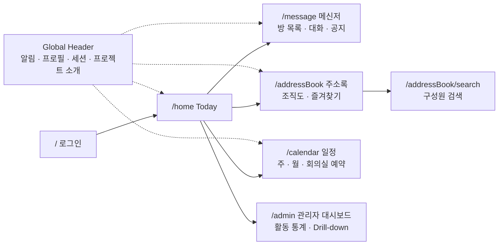
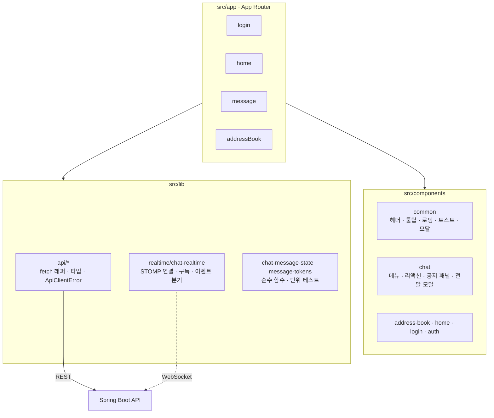
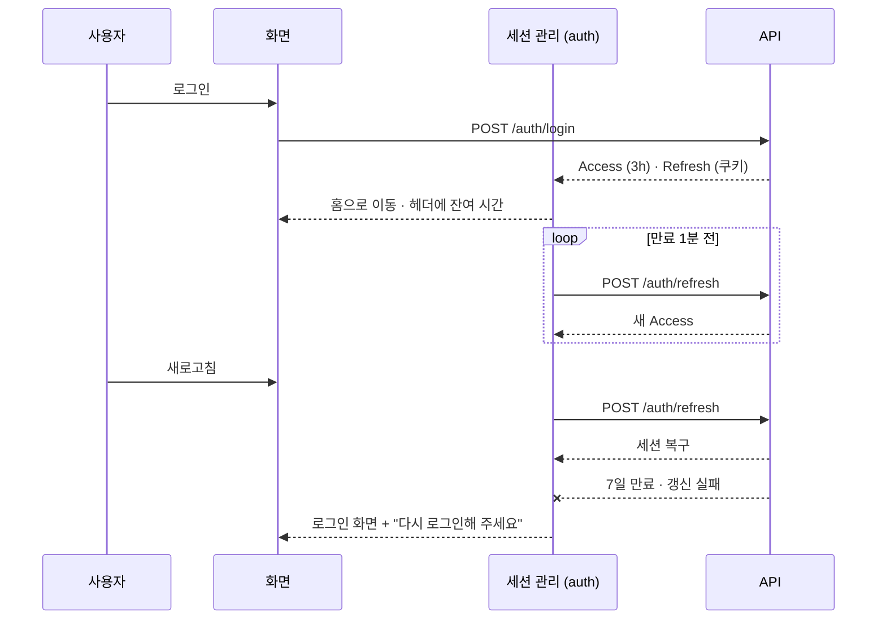
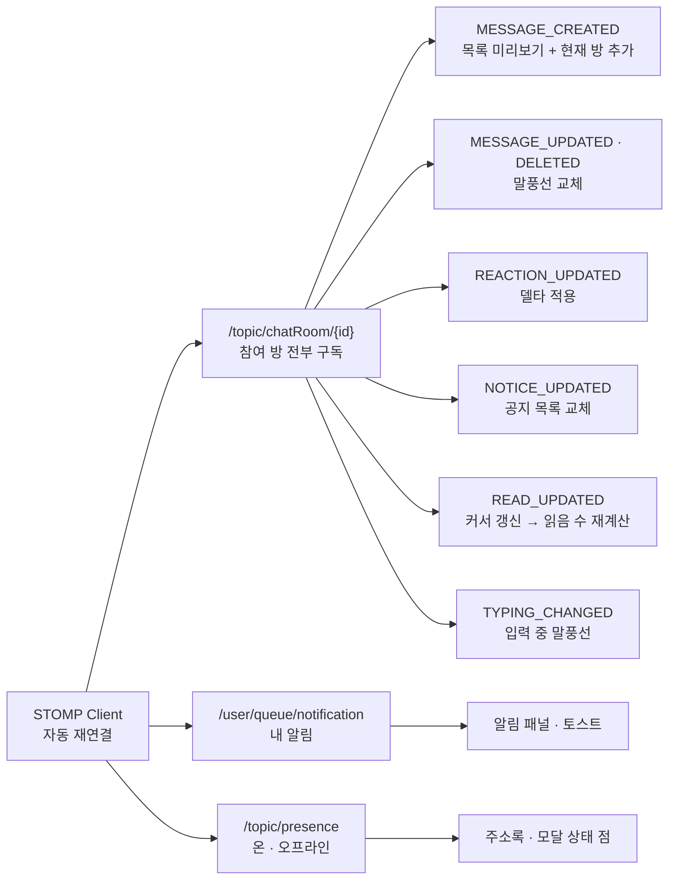
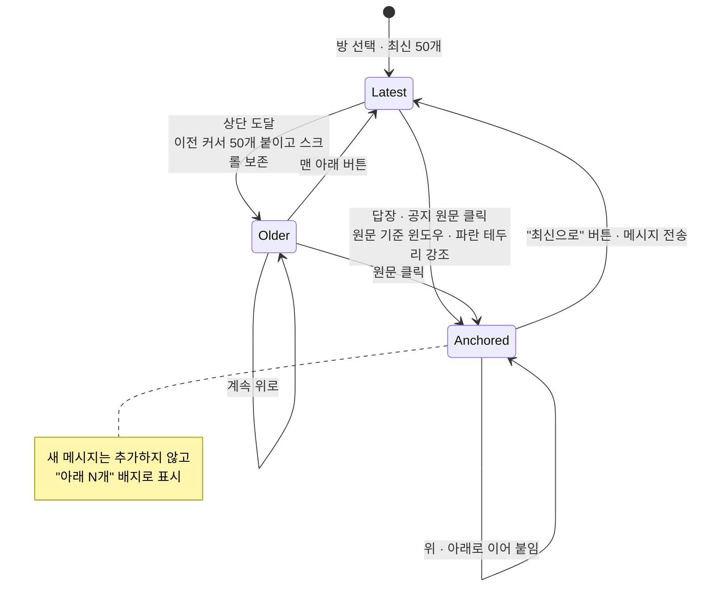
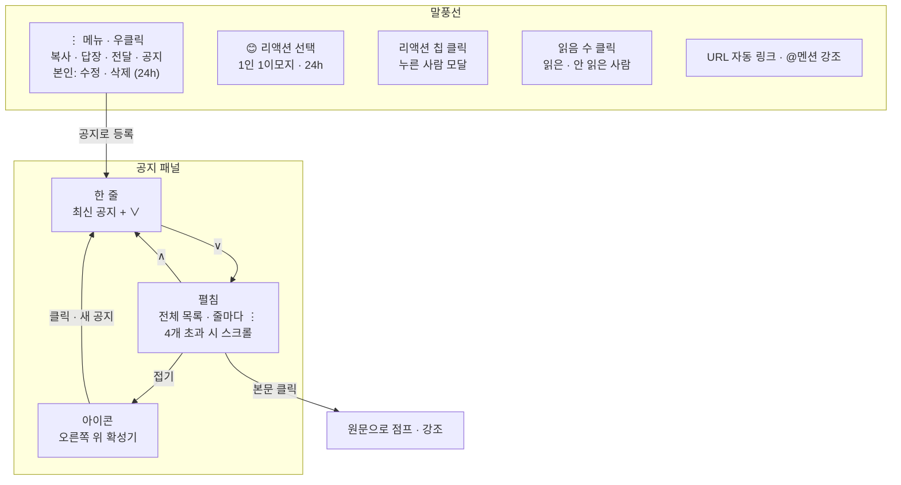
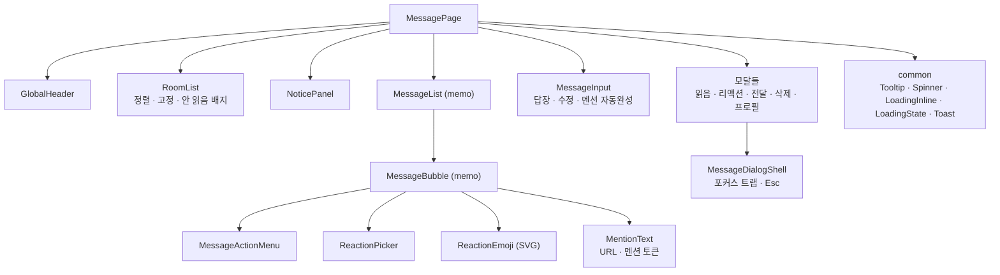
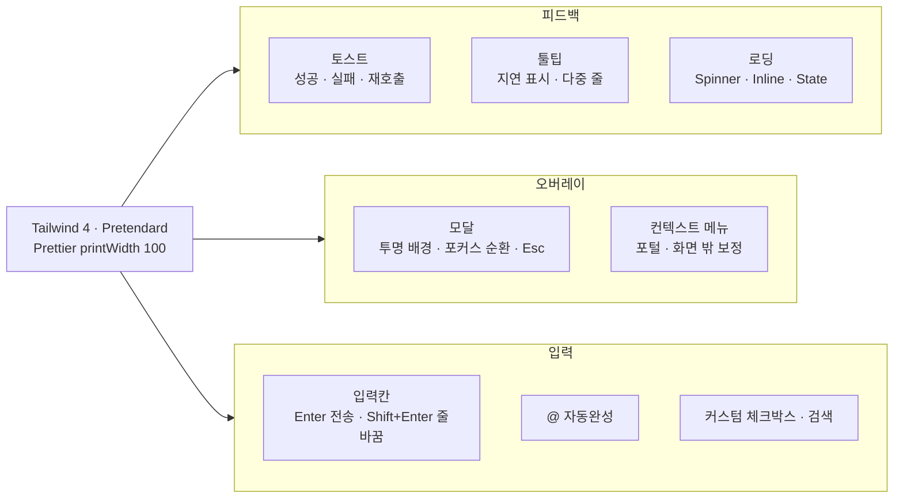
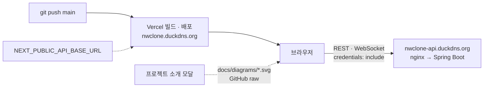
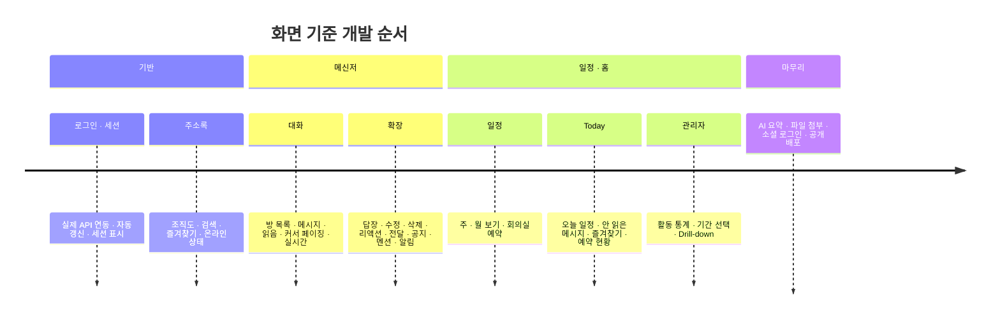

<div align="center">

# NaverWorks Clone · Frontend

### 오늘의 업무를 한 화면에, 팀의 대화를 끊김 없이


`Frontend Repository` · `Personal Portfolio Project` · [Backend Repository →](https://github.com/wjsgusdn12/naverworks_clone_api)

</div>

> 네이버웍스의 협업 경험을 참고해 설계한 개인 프로젝트입니다. 특정 서비스의 디자인을 그대로 복제하지 않습니다.
> 이 문서는 프론트의 **전체 설계**를 그림으로 보여 줍니다. 서버 설계는 [백엔드 README](https://github.com/wjsgusdn12/naverworks_clone_api#readme)에 있습니다.

---

## 1. 화면 지도

로그인 뒤 Today 홈이 시작점입니다. 홈에서 메신저·주소록·일정으로 갈라지고, 관리자는 같은 자리에서 활동 대시보드를 봅니다.

<!-- diagram: screen-map -->


모든 화면 위에 공통 헤더가 유지됩니다. 알림 패널·프로필 메뉴·세션 잔여 시간·프로젝트 소개 모달이 여기에 붙습니다.

---

## 2. 앱 구조

App Router 아래에 화면이 있고, 화면은 `components`의 조각과 `lib`의 API·실시간·순수 계산 함수를 조립합니다. 서버 상태는 화면이 직접 들고, 전역 라이브러리는 필요가 증명되기 전까지 넣지 않습니다.

<!-- diagram: app-architecture -->


`lib`의 순수 함수(읽음 수 재계산, URL·멘션 토큰 분리)는 React 없이 node 테스트로 검증합니다.

---

## 3. 인증 UX

Access Token은 메모리에만 두고 만료 1분 전에 조용히 갱신합니다. 세션 전체(7일)가 끝나거나 갱신이 실패하면 로그인 화면으로 보내고, 헤더에는 남은 시간을 표시합니다.

<!-- diagram: auth-ux -->


실패는 `alert` 대신 토스트와 입력 피드백으로 알립니다. 역할별 화면 차이는 서버가 돌려준 권한을 받은 뒤에만 적용합니다.

---

## 4. 실시간 동기화

STOMP 연결 하나로 방 토픽과 개인 큐를 구독합니다. 이벤트 종류마다 핸들러가 나뉘고, 현재 보고 있는 방의 이벤트만 화면 상태를 바꿉니다.

<!-- diagram: realtime-sync -->


재연결하면 현재 방을 다시 조회해 끊긴 사이의 변화를 메웁니다. Pub/Sub은 저장하지 않기 때문입니다.

---

## 5. 메시지 화면 상태

대화는 50개 단위 윈도우로 다룹니다. 위로 스크롤하면 이전 페이지를 붙이고, 답장 원문으로 점프하면 그 위치 중심의 새 윈도우를 엽니다. 최신으로 돌아오기 전까지는 새 메시지를 "아래 N개" 배지로만 알립니다.

<!-- diagram: message-state -->


읽음 수는 서버 값과 참여자 커서를 합쳐 화면이 다시 셉니다. 이벤트 도착 순서가 뒤바뀌어도 숫자가 흔들리지 않습니다.

---

## 6. 메신저 인터랙션

말풍선 하나에 붙는 동작과, 방 상단의 공지 패널이 오가는 모양입니다.

<!-- diagram: messenger-interaction -->


메뉴는 포털로 띄워 스크롤 영역에 가려지지 않고, 화면 아래쪽에서는 위로 접힙니다. 모든 확인은 커스텀 모달이고 브라우저 `confirm`은 쓰지 않습니다.

---

## 7. 컴포넌트 트리

메시지 화면이 가장 큽니다. 목록과 말풍선은 `memo`로 감싸 다른 말풍선이 바뀌어도 다시 그리지 않고, 콜백은 참조가 고정된 래퍼로 넘깁니다.

<!-- diagram: component-tree -->


공통 UI는 한 곳에 두고 어디서든 붙입니다. 로딩 표시 세 가지(아이콘만 · 한 줄 · 영역 전체)를 상황에 맞게 고릅니다.

---

## 8. 공통 UI 체계

브라우저 기본 UI를 쓰지 않고 서비스 전반에 같은 모양을 유지합니다.

<!-- diagram: ui-system -->


접근성 속성(`aria-*`, `role`)을 모든 상호작용 요소에 붙이고, 키보드만으로 메뉴와 모달을 다룰 수 있게 합니다.

---

## 9. 배포 흐름

프론트는 Vercel이 main 브랜치를 받아 바로 배포합니다. API 주소는 환경변수 하나로 바뀌고, 서버와는 다른 사이트이므로 쿠키와 CORS를 그에 맞춰 설정합니다.

<!-- diagram: deploy -->


앱 안의 "프로젝트 소개" 모달은 두 저장소의 README 다이어그램을 그대로 보여 줍니다. README를 고치면 모달도 같이 바뀝니다.

---

## 10. 로드맵

<!-- diagram: roadmap -->


---

## 기술 스택

| 분류 | 선택 | 이유 |
| --- | --- | --- |
| 프레임워크 | Next.js 16 · App Router · React 19 · TypeScript 5 | 화면 구조와 타입 안정성 |
| 스타일 | Tailwind CSS 4 · Prettier | 빠른 조립과 일관된 포맷 |
| 아이콘 | lucide-react · 직접 그린 리액션 SVG | 가볍고 통일된 선 굵기 |
| 실시간 | @stomp/stompjs | 서버 STOMP 브로커와 연결, 자동 재연결 |
| 상태 | React 상태 · `useStableCallback` · `memo` | 라이브러리 없이 렌더링 범위 제어 |
| 테스트 | node:test · eslint(react-hooks 컴파일러 규칙) · tsc | 순수 함수 검증과 정적 검사 |
| 배포 | Vercel · DuckDNS | 비용 0원 |

## 로컬 실행

```powershell
npm install
# .env.local 에 NEXT_PUBLIC_API_BASE_URL=http://localhost:9090
npm run dev          # http://localhost:3000

npm run lint
npx tsc --noEmit
node --test "tests/**/*.test.mjs"
```

## 문서

- [백엔드 README](https://github.com/wjsgusdn12/naverworks_clone_api#readme) · [전체 설계·요구사항](https://github.com/wjsgusdn12/naverworks_clone_api/blob/main/docs/PROJECT_CONTEXT.md)
- 이 README의 다이어그램은 `scripts/build-diagrams.mjs`가 `docs/diagrams/`에 SVG로 뽑아 두며, 앱의 "프로젝트 소개" 모달이 같은 파일을 보여 줍니다.
