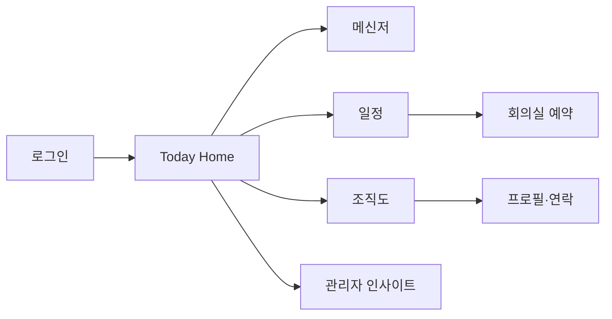
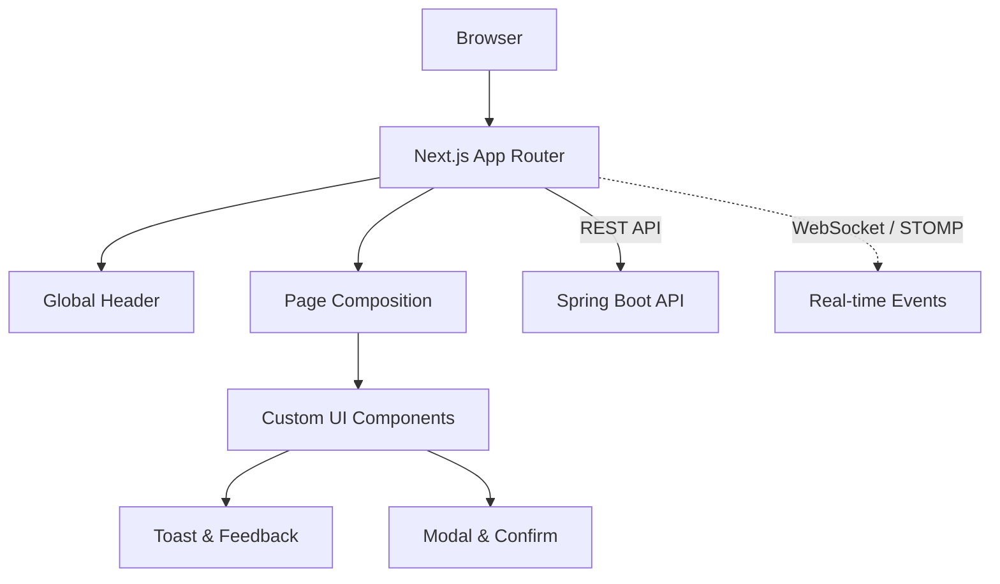
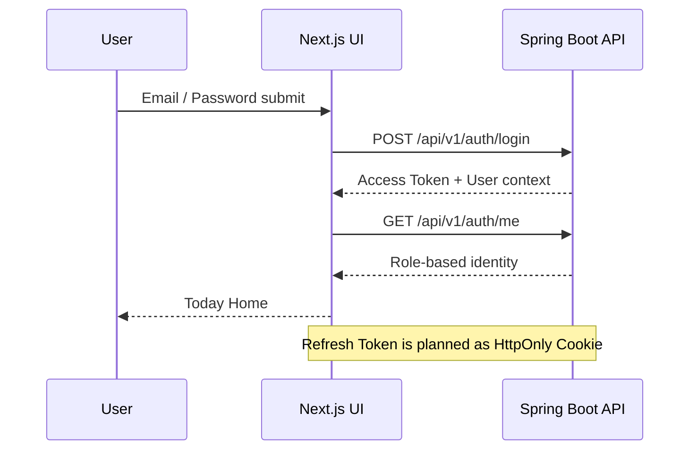

<div align="center">

# NaverWorks Clone

### 오늘의 업무를 한 화면에, 팀의 협업을 하나의 흐름으로


`Frontend Repository` · `Personal Portfolio Project`

</div>

---

## ✦ Project Story

협업 서비스의 첫 화면은 단순한 대시보드가 아니라, 사용자가 **오늘 해야 할 일과 팀의 흐름을 가장 빠르게 이해하는 업무 시작점**이어야 합니다.

**NaverWorks Clone**은 로그인부터 Today 홈, 메시지, 일정, 조직 정보, 관리자 인사이트까지 이어지는 협업 경험을 설계하는 프로젝트입니다. 이 저장소는 사용자의 행동에 즉시 반응하고, 서버의 실제 권한과 데이터 상태를 정확히 전달하는 UI/UX를 담당합니다.

| Project Snapshot    | Description                                              |
| ------------------- | -------------------------------------------------------- |
| Product             | 메신저·일정·회의실·조직 정보를 연결하는 기업 협업 플랫폼 |
| UX Goal             | 업무 맥락을 잃지 않는 Today 중심의 화면 흐름             |
| Repository Role     | 화면 구조, 인터랙션, 인증 UX, API·실시간 이벤트 표현     |
| Collaboration Model | Spring Boot API와 분리된 Next.js Frontend                |

> 네이버웍스의 협업 경험을 참고하되, 특정 서비스의 디자인을 그대로 복제하지 않습니다.

---

## ✦ Product Experience



| Surface          | Experience                                                                 |
| ---------------- | -------------------------------------------------------------------------- |
| **Login**        | 브랜드 일관성을 지닌 입력 UX, 로그인 유지, 소셜 진입점, 명확한 실패 피드백 |
| **Today**        | 오늘 일정·읽지 않은 대화·즐겨찾는 구성원·예약 현황을 한 화면에서 확인      |
| **Messenger**    | 대화·읽음·반응·답장·공지·파일의 흐름을 방해하지 않는 실시간 인터페이스     |
| **Calendar**     | 개인·조직 일정을 확인하고, 회의실 예약을 자연스럽게 연결                   |
| **Organization** | 조직 구조와 구성원 연락 수단을 빠르게 탐색                                 |
| **Admin**        | 서비스 활동과 조직 운영 상태를 분리된 관점으로 확인                        |

---

## ✦ UI Architecture



### UX Principles

| Principle              | Implementation direction                                              |
| ---------------------- | --------------------------------------------------------------------- |
| Feedback first         | 클릭·Hover·토스트·모달로 사용자의 행동 결과를 바로 전달               |
| Custom consistency     | 기본 브라우저 UI 대신 서비스 전반에 일관된 컴포넌트 디자인 적용       |
| Server-driven trust    | 화면의 역할 노출은 UX이고, 실제 권한 판단은 서버 응답을 기준으로 처리 |
| Graceful states        | Loading·empty·error·reconnect 상황을 기능 단위로 설계                 |
| Progressive disclosure | 자주 쓰는 Today 정보는 전면에, 부가 기능은 필요한 순간에 노출         |

---

## ✦ Design System

| Element     | Direction                                                                 |
| ----------- | ------------------------------------------------------------------------- |
| Typography  | Pretendard 기반의 가독성 높은 업무용 정보 계층                            |
| Layout      | Desktop first를 기준으로 하되, 좁은 화면에서도 구조가 무너지지 않게 대응  |
| Navigation  | 모든 화면에 유지되는 Global Header와 서비스 아이콘 툴팁                   |
| Interaction | Hover 상태·열림/닫힘·토스트 등장/재호출 등 행동 중심 애니메이션           |
| Form        | 로그인 입력, 비밀번호 표시, 체크박스, 소셜 버튼까지 커스텀 UI 일관성 유지 |

---

## ✦ Tech Stack

| Layer     | Technology                  | Why                                       |
| --------- | --------------------------- | ----------------------------------------- |
| Framework | Next.js 16.4.2 / App Router | 페이지 구조와 React 기반 UI 구성          |
| UI        | React 19.3.0, TypeScript    | 컴포넌트 재사용성과 타입 기반 안정성      |
| Styling   | Tailwind CSS 4 + Custom CSS | 빠른 레이아웃 구성과 세밀한 인터랙션 제어 |
| Icons     | lucide-react, react-icons   | 서비스 탐색·행동을 직관적으로 전달        |
| API       | Spring Boot JSON API        | 인증과 업무 데이터의 서버 원천            |
| Real-time | WebSocket / STOMP           | 메신저·알림 UX 구현 시 연결               |

TanStack Query, Zustand, shadcn/ui는 요구가 명확해질 때 도입 여부를 판단합니다. 라이브러리 수보다 프로젝트에 맞는 상태 관리 경계를 우선합니다.

---

## ✦ Authentication Experience



- 로그인 실패는 `alert`가 아닌 토스트·입력 피드백으로 안내합니다.
- Access Token은 메모리 기반, Refresh Token은 HttpOnly Cookie 기반으로 설계합니다.
- 일반 사용자와 관리자의 화면 차이는 서버가 검증한 권한 정보 이후에만 적용합니다.
- 네이버·카카오·구글 소셜 로그인은 OAuth2 서버 연동 시점에 실제 흐름으로 확장합니다.

---

## ✦ Product Roadmap

| Journey      | Frontend focus               | Connected backend capability      |
| ------------ | ---------------------------- | --------------------------------- |
| Identity     | 로그인·로그아웃·인증 복구 UX | JWT Access / Refresh Token        |
| Organization | 조직도·구성원 검색·프로필    | Company / Department / Membership |
| Conversation | 1:1·그룹 채팅·읽음·Reaction  | REST + WebSocket/STOMP            |
| Schedule     | Today·개인/조직 일정·예약    | Calendar / Meeting Room API       |
| Insight      | 역할별 홈·관리자 대시보드    | RBAC / Activity Aggregation       |

---

## ✦ Local Setup

### Prerequisites

- Node.js 24+ 권장
- npm

### Run Frontend

```powershell
npm install
npm run dev
```

Open [http://localhost:3000](http://localhost:3000).

### Quality Check

```powershell
npm run lint
npm run build
```

---

## ✦ Project Status

로그인·Today 홈·공통 헤더·토스트·모달 등 협업 화면의 기본 인터랙션을 구성했습니다. 다음 단계는 Spring Boot 인증 API와 실제 사용자 데이터를 연결해 화면의 목업 상태를 서버 상태로 전환하는 것입니다.

전체 서비스의 백엔드 설계와 기술 실험 문서는 아래에서 확인할 수 있습니다.

- [Backend Repository](https://github.com/wjsgusdn12/naverworks_clone_api)
- [Full Project Context](https://github.com/wjsgusdn12/naverworks_clone_api/blob/main/docs/PROJECT_CONTEXT.md)
- [Engineering Experiments](https://github.com/wjsgusdn12/naverworks_clone_api/blob/main/docs/ENGINEERING_EXPERIMENTS.md)
